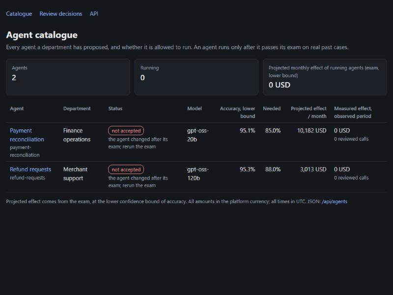
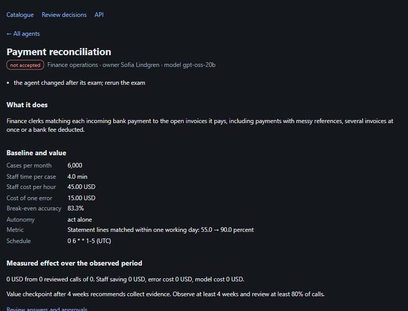
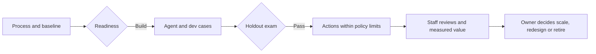

# AI agent launch platform

A department starts with a process and its cost. The platform checks whether the written
process is clear enough to automate, examines the agent on past cases, controls what it may
do, and measures its value after launch.

Two agents work inside Harbourline Payments, a fictional payments company. Payment
reconciliation uses rules for exact matches and a model for messy references. Refund requests
use a model to read the customer's reason and rules to apply the refund policy. All example
business data, readiness observations and case labels are synthetic.

The catalogue lists every agent with its exam result, the accuracy it needs and its projected
monthly effect. Each agent has a page with its baseline, autonomy and measured value.





## Quick start without a model key

Install Python 3.12 or later and [uv](https://docs.astral.sh/uv/getting-started/installation/).
From the repository root, these commands work on Windows, macOS and Linux.

```sh
uv sync --frozen
uv run pytest -q
uv run agents validate
uv run agents readiness
uv run agents exam payment-reconciliation --set dev --model mock
uv run agents exam refund-requests --set dev --model mock
```

Start the sandbox in one terminal and the catalogue in another.

```sh
uv run agents sandbox
```

```sh
uv run agents serve
```

Open the [sandbox API](http://127.0.0.1:8100/docs), the
[catalogue](http://127.0.0.1:8000/) and the [staff page](http://127.0.0.1:8000/operations).
The sandbox starts with customers, invoices, bank statement lines, orders and refund requests.
Its data resets when its process restarts. Each process has its own sandbox data. Agent jobs
call sandbox functions in-process through the platform tool registry.

Mock exams cost nothing and use a few keywords. Dev reports expose their mistakes and handovers
for inspection. They leave the agent awaiting real acceptance.
To expose the same sandbox functions over MCP, run this stdio server from an MCP client.

```sh
uv run python -m sandbox.mcp_server
```

## Example agents and recorded acceptance



The example agents completed acceptance on 11 November 2026 using the synthetic holdout sets.
Counts below are cases. Each case ran three times, and an answered case counts as correct
only when all three runs were correct.

| Agent | Model on Groq | Answered correctly | Correct handovers | Wrong answers | Accuracy lower bound |
| --- | --- | ---: | ---: | ---: | ---: |
| [Payment reconciliation](agents/payment-reconciliation) | GPT-OSS 20B | 32 | 8 | 0 | 95.1% |
| [Refund requests](agents/refund-requests) | GPT-OSS 120B | 33 | 7 | 0 | 95.3% |

Both exams contain 40 cases and zero infrastructure failures. The accuracy lower bound uses
90% one-sided confidence. The run summary and downloadable reports preserve the evidence.
[Recorded acceptance run](https://github.com/kirmskhq/ai-agent-launch-platform/actions/runs/42999716228).

A statement line of 1,837.50 with the reference `inv 1201 + 1202 minus fee` names invoices of
1,200 and 650. The model proposes those invoice IDs. Rules check ownership, amounts and the
permitted fee, then record the match. Unclear matches go to finance staff.
The [written refund policy](sandbox/refund_policy.md) shows the other workflow, including
refund windows, evidence requirements and the 50-unit approval limit.

## How a department proposes an agent

```sh
uv run agents propose invoice-follow-up
```

Fill in `agents/invoice-follow-up/proposal.yaml` before writing its graph. Record the process
owner's name, role, sign-off date, steps, decisions and their rules, inputs, outputs, systems
and exceptions. Include work volume, minutes per case, staff hourly cost, cost of one error
and how an error can be undone. Choose one metric with a baseline and target, and one guardrail
metric with a limit.

Ask two staff members to independently run the same 30 or more past cases through the written
process. Replace the starter rows in `readiness/reality_test.jsonl` with their observations.

```sh
uv run agents readiness invoice-follow-up
```

Coverage is the share settled by the written rules for both staff members. Agreement is the
share where they reached the same answer. Staff agreement caps the agent's exam threshold.
The default bar requires 80% coverage and 85% agreement.

Every check passes or fails individually. The platform recommends build, fix the process first,
or decline, with reasons. Insufficient financial value or break-even accuracy above staff
agreement leads to decline. An incomplete process leads to fixing the process first. The
owner records a dated decision and reason. A build decision requires passing checks. The
platform team sets the bar in `config/platform.yaml`.

Once cleared, add `agent.yaml`, `graph.py`, optional `job.py`, and separate `evals/dev.jsonl`
and `evals/holdout.jsonl` files. For writes, add `action.py` exposing
`build_action(payload, output)`, returning a tool name and arguments after the graph checks
the decision. Validation rejects agent code before readiness clearance.
CI checks the current files. Git history and human review establish the actual development order.

## Economics and autonomy

Let S be staff cost saved on one correct answer, E the cost of an error, C model cost and p
answer accuracy. Expected effect is `p*S - (1-p)*E - C`. Break-even accuracy is `(E+C)/(S+E)`.
The passport enforces the floor before model cost is known. The exam checks actual model cost
and projected net at the accuracy lower bound. Handovers save zero staff time and incur model cost.

| Tier | When permitted | Runtime behaviour |
| --- | --- | --- |
| Advise | Any cleared process | Produce an answer for staff |
| Act after approval | Error is reversible or cheap | Queue writes for approval |
| Act alone | Error is reversible and costs at most 50 by default | Execute allowed clear actions |

The refund policy further restricts its agent. Refunds above 50 require staff approval.
The passport lists permitted tools. The runner opens those tools with writes disabled while
answering and during exams. A separate action step enables a permitted write.

## Exams and acceptance

Build against dev cases. Keep holdout labels away from prompt development. Input overlap
between the two files fails validation. Each holdout case runs three times and counts as
correct only when every run is correct. Reports show consistency and five outcomes.

- Answered correctly
- Answered wrongly
- Correct handover
- Unneeded handover
- Infrastructure failure

Acceptance uses the one-sided Wilson lower bound at 90% confidence, minimum answered share,
case count and cost limits. Infrastructure failures leave the exam incomplete. Provider errors
receive bounded retries respecting Retry-After. Failed case-runs receive one final sequential
retry pass. Wrong answers keep their original score.

```sh
uv run agents exam payment-reconciliation --set dev
uv run agents exam payment-reconciliation
uv run agents exam refund-requests
uv run agents exam payment-reconciliation --model mock
uv run agents compare reports/payment-reconciliation.json reports/trials/payment-reconciliation@mock.json
```

Reconciliation selects Groq's `openai/gpt-oss-20b`. Refund requests select
`openai/gpt-oss-120b`, which cleared the stricter refund acceptance bar. Copy `.env.example` to `.env` and set
`GROQ_API_KEY=your-key`. For GitHub Actions, add GROQ_API_KEY as a repository secret.
Configuration also supports OpenAI and OpenRouter.

`config/models.yaml` holds model IDs, endpoints, request options, retry limits and token prices.
Amounts use the currency in `config/platform.yaml`, default USD. Published token prices provide
cost estimates on free plans too. Provider invoices can differ. Set the USD conversion rate
when choosing another currency. Keep currency fixed during an observation period.

Pull-request CI runs real exams when the model's key exists. Exams are serialized across
branches sharing the key. Pushes to main run code checks, and manual CI runs can repeat exams. Results appear in the job summary and the
exam-reports artifact. CI can pass code checks while skipping exams. Read the actual exam
summary before accepting an agent. CI can reuse a passed report from the latest completed
branch run after the installer verifies the complete fingerprint. Changed agents require
fresh exams. Infrastructure failures can resume from saved progress, while recorded wrong
answers keep their original scores. The summary states when an accepted report is reused.

## Resume an interrupted exam

```sh
uv run agents exam refund-requests --resume
```

The platform saves an atomic checkpoint after every completed run. A checkpoint contains all
three slots for every case, including pending slots. Resuming keeps recorded correct answers,
wrong answers and handovers, and retries only infrastructure failures or unfinished slots.
The final Wilson bound and costs are recalculated from the combined evidence. Retry costs
are added to the original run's costs.

Agent code, model, settings, cases and run count must match. Acceptance fingerprints also
include the sandbox refund policy, `pyproject.toml` and `uv.lock`; changing these requires a
fresh exam. Reports created before these dependencies were fingerprinted require fresh exams too.

CI first restores a previous attempt of the same run, then falls back to the latest
completed branch artifact, and validates its reports before resuming. New branches can reuse
reports from an ancestor commit in the same repository after the same fingerprint and
evidence checks. Reports originating from another repository are excluded from automatic reuse. A complete failed quality exam keeps its
wrong answers and fails again. A changed agent requires a fresh exam.

```sh
uv run agents import-exam /path/to/downloaded/refund-requests.json
uv run agents exam refund-requests --resume
```

Reports from the version immediately before checkpoint support have one audited migration.
It checks their original fingerprint against the pinned Git commit, verifies that inference,
scoring, calculations and agent loading logic match, and records the source fingerprint.
Other incompatible reports are rejected. Full Git history is required for that migration.

## Pull deployment

The running service reads code, passports and acceptance reports from local files. The host
pulls a reviewed commit, syncs locked dependencies and installs that commit's reports. The
exam service needs no deployment credentials on the host.

Download exam-reports from a trusted CI run, then run these commands.

```sh
git pull --ff-only
uv sync --frozen
uv run agents accept-report /path/to/downloaded/payment-reconciliation.json
uv run agents accept-report /path/to/downloaded/refund-requests.json
uv run agents status
```

The installer checks real holdout acceptance, the passport model and the current fingerprint,
then atomically installs the report. Reports are excluded from Git. Protect that directory
as deployment authority. Reports are trusted local artifacts without cryptographic signatures.

The fingerprint covers agent code, holdout cases, exam settings, baseline, model and provider
configuration, tool policy and relevant runtime code. Changes require another exam. Restart
the service after pulling code so its imported platform modules match the deployed files. Readiness
is checked again when deriving status. Draft and retired agents stay disabled.

To route through LiteLLM, generate its configuration and run a LiteLLM proxy using the generated
file. Set AGENTS_GATEWAY_URL and AGENTS_GATEWAY_KEY on the agent host. The proxy holds provider
keys. Direct OpenAI-compatible connections are also supported.

```sh
uv run agents litellm-config
uv run agents litellm-config --check
```

## Production decisions, reviews and value

Systems and people get different tokens. AGENTS_API_TOKEN is a service token: it runs agents
and reads decisions. Each person who reviews answers or approves actions gets a personal token
in AGENTS_STAFF_TOKENS, with the role `reviewer` or `approver`.

```sh
AGENTS_API_TOKEN=replace-with-a-long-secret
AGENTS_STAFF_TOKENS={"Dana": {"token": "another-long-secret", "role": "approver"}}
```

Start the service and open `/operations` with a staff token. The page shows who the token
belongs to, inputs, answers, pending approvals and action results. Reviewers mark answers
right or wrong. Approvers also approve or reject queued actions. A review or approval is
recorded under the token owner's name, so a service token can do neither.

| Endpoint | Token | Purpose |
| --- | --- | --- |
| POST /api/agents/{name}/invoke | service | Run one input with body `{"input": {...}}` |
| POST /api/agents/{name}/run | service | Collect pending work and run a batch |
| GET /api/decisions | any | Read the token's company's decisions and approval queue |
| POST /api/decisions/{id}/review | reviewer, approver | Body `{"correct": true}` |
| POST /api/decisions/{id}/approval | approver | Body `{"reject": false}` |
| GET /api/agents/{name}/value?weeks=4 | any | Measured value and checkpoint recommendation |
| GET /api/me | any | Name, company and role of the token |

Set AGENTS_TENANT_TOKENS to a JSON object mapping tenant names to service tokens for multiple
companies. A staff entry names its company with `"tenant": "team-a"`, otherwise it belongs to
the default company. Every token must be nonempty and distinct across all three settings.
The service checks token settings once at start and refuses to start when they are invalid.
Restart it after changing a token. The server derives the company from the token. Decisions,
approvals and in-memory sandbox data follow that company. The default token and scheduler
serve the default company. Catalogue metadata and default-company aggregate values are public.

Invocation responses keep the agent's answer in `output` and report write outcomes separately:
`action_state` is `null` when no action was proposed, or a decision state such as `pending`,
`executed`, `failed`, `unknown`, or `duplicate`. `action_result` contains the tool result when
available. An HTTP 200 means the invocation was processed; check `action_state` before treating
an action as completed. `unknown` means the write may have happened and requires reconciliation;
do not retry it blindly. Pending approvals and duplicate decisions have no new tool result.

Failed and unknown writes set `fell_back_to_person` to true while preserving the original
agent answer. This flag signals that staff attention is required; it does not dispatch a staff
notification. The CLI also prints the action state and result. Job summaries include
`action_counts` by state and count failed or unknown writes as handed over rather than answered.
Pending actions remain answered decisions awaiting approval, not completed writes.

SQLite records invocations before they begin and updates their outcomes in `var/decisions.sqlite3`. An action is claimed durably
before its tool runs. An interrupted model call remains in progress for staff inspection. Interrupted actions retain an unknown outcome for staff reconciliation.
Repeated recorded actions are blocked after one executes or becomes unknown. Approval also
checks the original decision's code and configuration against the current accepted agent.

Measured effect covers the observed period. It credits baseline staff time for reviewed correct
answers and completed actions, subtracts declared error cost for wrong answers, and charges
all calls. Pending approvals, handovers and failed actions save zero time. Unreviewed answers
receive no credit. This estimates value from the baseline and reviewed outcomes. Actual staff
minutes require a time study.

The catalogue places measured observed-period effect beside projected monthly effect from the
exam. After N weeks, with at least 80% of calls reviewed, the checkpoint recommends scale up
for positive net, shut down for negative net, or redesign at break-even. A reviewer retires an
agent by setting `lifecycle: retired`.

```sh
uv run agents value refund-requests --weeks 4
```

All schedules use UTC. Set AGENTS_SCHEDULER=1 to run the scheduler inside the service.
Use one service worker when scheduling. Scheduled runs cannot overlap within that process.

## Design decisions and trade-offs

- Rules handle exact arithmetic, limits and policy dates. Models read limited pieces of text.
  Tasks settled by rules need no model call.
- A department first measures a missing baseline. A low-value process is declined. A process
  with poor staff agreement is repaired before development.
- Pull deployment gives the host control over reviewed code and accepted reports.
- The lower bound accounts for small samples. Repeated runs expose inconsistent behaviour.
- One graph per agent keeps paths inspectable. Multi-agent debate, model-driven policy decisions,
  weighted readiness scores and autonomous handling of ambiguous cases were rejected.
- Personal bearer tokens with two staff roles fit a small deployment and tie each review and
  approval to a named person. Larger organisations need an identity provider, token rotation
  and revocation without a restart. Use HTTPS at the ingress for remote access.

## Limitations

- The sandbox is synthetic, in-memory and single-process. HTTP and MCP instances have separate
  data. Restarting loses mutations while the decision log survives. Reconcile the log when
  resetting a sandbox used for an observation period.
- SQLite supports a single host. External payment systems need idempotency keys, durable
  reconciliation and transaction boundaries appropriate to their tools.
- Agent Python code is trusted. Tool grants govern the registry. Operating-system isolation
  is needed to restrict arbitrary Python imports and network access.
- Staff reviews can be biased. The checkpoint uses declared error cost and sampled reviews.
  Business targets and guardrails still need independent operational measurement.
- Provider budgets and model availability change. Free daily token limits can permit roughly
  one full exam run per day. Inspect provider headers and logs.
- A small synthetic holdout leaves uncertainty about real production coverage. A changed
  business process needs fresh cases and another readiness review.

## Code map

| Area | Entry points |
| --- | --- |
| Proposal and financial case | [readiness.py](agent_platform/readiness.py), [economics.py](agent_platform/economics.py) |
| Model access and tool permissions | [gateway.py](agent_platform/gateway.py), [tools.py](agent_platform/tools.py) |
| Acceptance and resumable exams | [exam.py](agent_platform/exam.py), [registry.py](agent_platform/registry.py) |
| Decisions, approvals and measured value | [production.py](agent_platform/production.py), [service.py](agent_platform/service.py), [auth.py](agent_platform/auth.py) |
| Example implementations | [agents](agents), [sandbox](sandbox) |

## Development

```sh
uv run ruff check .
uv run ruff format --check .
uv run pytest -q
```

MIT licence. See LICENSE.
